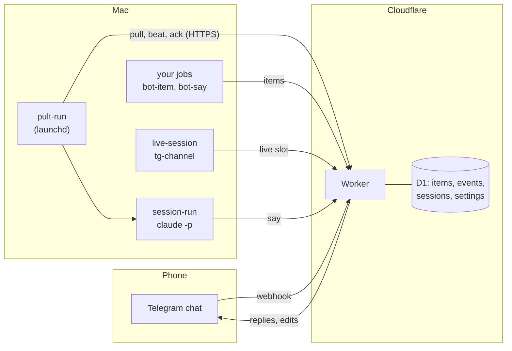

# pult

A Telegram remote for Claude Code, on your own Claude subscription. No API key anywhere.

*pult* is Russian for "remote control". You message a bot from your phone; a small Cloudflare worker puts the message in a queue; a runner on your Mac takes it, runs `claude -p` (resuming the right session), and the answer comes back as a Telegram reply. Scheduled jobs of your own put **cards with buttons** into the same chat. Tap a button and a read-and-draft job does the next step.

Written up in two posts: [My Telegram control bot](https://rustman.org/wiki/control-bot/) (the design and the rules behind it) and [Claude Code channels](https://rustman.org/wiki/claude-code-channels/) (the live terminal session).

## Why not the official Telegram channel plugin

The official plugin is a chat bridge: it pushes your Telegram messages into one open Claude Code session and takes replies back. That is exactly right when you sit at a terminal. pult adds what a bridge does not have:

| | Official channel plugin | pult |
|---|---|---|
| Needs an open terminal session | yes | no: a queue and a headless runner (`claude -p`) |
| Several conversations | one session | sessions you address by replying; `/new`, `/sessions`, `/stop` |
| Things your scripts want to show you | no | cards with Done / Later / Not needed / More buttons |
| Claude usage limit | the open session is yours to nurse | the runner pauses the queue; events wait and run after the reset |
| Button jobs that must not act | n/a | read-and-draft by tool rules, not by prompt |
| Live terminal session | yes | yes, as an optional channel (`bin/live-session`) |

## How it fits together



The worker holds the only Telegram token. The Mac holds a key to the worker, nothing else. Only your Telegram user id is ever answered; every other sender gets no reply at all.

### What the worker does

- **Webhook** with a secret and an owner-only gate.
- **Items**: cards (`decision`), living notes (`inbox`, `digest`), incidents, meetings. One message per item, edited in place, collapsed to one line when settled, replaced when it wakes from "Later".
- **Queue**: P0 your text, P1 your button presses, P2 jobs you queue yourself. A runner leases one event (90 s), heartbeats it, and acks it with the lease id; a dead lease returns the event to the queue (3 tries, 24 h expiry). One running turn per session.
- **Sessions**: a plain message goes to the day's session; a reply to any bot message continues the session that message belongs to; `/new [title]` starts one until midnight; `/sessions` switches; `/stop` interrupts (as a reply: that session).
- **Files**: photos, voice notes, documents (up to 20 MB) are passed as references; the runner downloads them through the worker, only for an event it currently holds.
- **Live slot**: a terminal session attached through the channel gets your plain messages while it runs, and hands them back to the runner when it exits.
- **Say**: `/sessions/<id>/say` converts Claude's Markdown to Telegram HTML (tables become bullets), edits a keyed progress line in place, and replies to the message you wrote.

### What the Mac side does

| Script | Job |
|---|---|
| `bin/pult-run` | the consumer: pulls events and hands each to `session-run`. Run it under launchd |
| `bin/session-run` | one event in, one Claude turn out: workflow lookup, `--resume`, files, voice transcription, live progress line, heartbeat, `/stop`, usage-limit handling |
| `bin/bot-item` | put a card, a note, an incident into the store; list, close, add details |
| `bin/bot-say` | a plain message, or a living note edited in place |
| `bin/live-session`, `bin/tg-channel` | start Claude Code with your Telegram chat wired in as a [channel](https://code.claude.com/docs/en/channels) |
| `workflows.json` | what each kind of run may do: cwd, permission mode, tool allow and deny lists |

## Setup

You need: a Cloudflare account (the free plan is enough), Node 22+, `uv`, Python 3.13, and Claude Code logged in on the Mac that will run the turns.

1. **Bot.** In Telegram, ask @BotFather for `/newbot`. Keep the token. Find your own numeric user id (any "what is my id" bot works).
2. **Worker.**
   ```bash
   make install
   cd worker
   npx wrangler d1 create pult                      # prints the database id
   cp wrangler.toml.example wrangler.toml           # fill in database_id, CHAT_ID, OWNER_TZ
   npx wrangler secret put TELEGRAM_BOT_TOKEN
   npx wrangler secret put TG_SECRET                # any long random string
   npx wrangler secret put RUN_KEY                  # another one; the Mac sends it as a bearer key
   npx wrangler deploy
   curl -H "Authorization: Bearer $RUN_KEY" https://<your-worker>.workers.dev/setup   # command menu, webhook, Mini App menu button; the database migrates itself on the first request
   ```
   Run one wrangler command at a time: two processes at once can invalidate the rotating OAuth login.
3. **Mac.**
   ```bash
   mkdir -p ~/.config/pult
   echo "https://<your-worker>.workers.dev" > ~/.config/pult/url
   printf '%s' "$RUN_KEY" > ~/.config/pult/run_key && chmod 600 ~/.config/pult/run_key
   python3 bin/pult-run --once          # a first pull; Ctrl-C if it idles
   ```
   For good, run `bin/pult-run` under launchd: see `examples/pult-run.plist`. Optional: a second key (`RUNNER_KEY` on the worker, `~/.config/pult/runner_key` here) that opens only the queue routes, so the runner can live on a machine that never holds the owner key.
4. **Mini App (optional).** The worker serves it at `https://<your-worker>.workers.dev/app/`, and `/setup` already set the chat menu button and `/app`. To get a Launch button on the bot's profile and a `t.me/<bot>/<app>` link, open @BotFather, choose your bot, `Bot Settings`, `Configure Mini App` (or `/newapp`), and give the URL above; the `startapp` links in this README use that short name. It stays read-only until you send `/appwrite on`.
5. **Try it.** Message the bot. A 👀 reaction means it is queued; the answer arrives as a reply. `/status` shows the queue.
6. **Cards.** `python3 bin/bot-item card --id test:1 --title "Check the build" --do "Check the build" --why "release is Friday"` puts a card in the chat. See `examples/job-example.sh`.

### The live channel

`bin/live-session` starts `claude` with this repo's MCP server as a development channel (Claude Code 2.1.80+, interactive mode only). While it runs, your plain Telegram messages arrive in that session as `<channel>` events and its `reply` tool answers in the chat. When it exits, messages go back to the queue at once; if it dies without detaching they go back after a minute. Claude Code asks for a confirmation on every start because a custom channel is not on the research-preview allowlist.

### Settings that matter

- `workflows.json`: `chat` is the default workflow for your messages and runs with `acceptEdits`. Switch to `bypassPermissions` only if you accept an agent that can run anything on your Mac from your phone. The `draft` workflow runs every card button and every reply to a card (see below).
- Env vars, all optional: `PULT_URL`, `PULT_HOME`, `PULT_WORK`, `PULT_STATE`, `PULT_CLAUDE` (argv prefix as JSON), `PULT_WORKFLOWS`, `PULT_SESSIONS_DIR`, `PULT_KEY_FILE`, `PULT_RUNNER_KEY_FILE`, `PULT_DENY_FILE`.
- Voice notes are transcribed before the model sees them: set a command under `transcribers` in `workflows.json` (the example uses `mlx_whisper`).

## A core with an extension layer

pult is built to be extended without being forked. The worker is a library: `createApp({ extensions })`, where an extension adds routes, slash commands, button prefixes, scheduled handlers, queue actions, Mini App panels and its own migrations. The Mac side is a Python package whose runner loads plugin modules named in `PULT_PLUGINS`. Your private layer pins this repo as a git submodule at a tag and depends on it by path; core changes are made here first. See [docs/extending.md](docs/extending.md) (with a tested toy extension), [CHANGELOG.md](CHANGELOG.md) for versions and [ROADMAP.md](ROADMAP.md) for what is next.

## Mini App

`/app` opens a Mini App served by the worker itself (`/app/`): open cards with their buttons, sessions with last activity, queue depth and the usage-limit pause, recent runs, plus a tab for every panel an extension registers. It is read-only until you flip a switch in D1 (`/appwrite on`), which lets the app press a card's buttons.

- **Auth.** Every API call carries Telegram's signed `initData`; the worker accepts the HMAC form (checked with your bot token) and the Ed25519 `signature` form (checked with Telegram's public key and the bot id, no token needed), within one hour, and only for the owner's user id. `MINIAPP_AUTH=hmac|ed25519|both` narrows it.
- **Deep links.** `https://t.me/<bot>/<app>?startapp=card_<short>`, `session_<id>` or `panel_<id>` opens that card, session or tab.
- **Same-origin rule (Bot API 10.2).** Mini App methods only work on the Mini App's own origin. The page is served from the worker, links out only to `https://` card sources in a new tab, and frames nothing; keep it that way and do not opt out of the hardening in BotFather.
- Fullscreen and add-to-home-screen buttons show on clients that support them (8.0+).

## Newer Telegram features, and how far they are tested

- **Streamed progress.** The runner shows what Claude is doing as a streamed draft (`sendMessageDraft`) with a Stop button (`can_stop`); the answer is a normal message. The Stop button arrives as `stopped_message_generation` and acts like `/stop`. `PULT_PROGRESS=edit` (Mac) or `PROGRESS_DRAFTS=0` (worker) goes back to editing one message.
- **Button colours.** Done is green, Not needed red, Later default; a card's running custom button is greyed out. `BUTTON_STYLES=0` and `BUTTON_DISABLED=0` turn them off.

**Status: untested against a real Telegram client.** They are covered by tests against a stub and fall back on refusal, but the draft rate limits and the minimum client versions are unverified. Check on a phone before you rely on them. The rest (topics as sessions, rich messages) is in [ROADMAP.md](ROADMAP.md).

## Safety model

- **Owner only.** The webhook checks the secret, then the sender's id and the chat id. Strangers, groups and bots are dropped before any handler runs, with no reply.
- **Keys in headers only.** Every non-webhook route wants `Authorization: Bearer <key>`. A key in a URL is refused.
- **Read and draft for buttons.** Card text is mail, chat or web content: untrusted. Every event that carries an item (a custom button, a reply to a card) runs in the `draft` workflow: a fresh Claude session, `dontAsk` permission mode, an allow list that can read and write drafts under `_work/drafts`, a deny list for the network and for secret files. The quoted card is wrapped as data. The tool rules enforce it, not the prompt.
- **Nothing sends except an explicit path.** There is no send tool anywhere. A common pattern is a **two-tap send**: the job attaches a draft to the card, the first tap shows the recipient and a confirm button, the second tap runs a plain script with no model in it that sends that exact draft. pult does not ship that script, because what "send" means is yours to decide.
- **Optional deny file.** `PULT_DENY_FILE` points at a file of regexes; an item or outgoing line that matches is dropped. If the variable is set and the file is missing, scripts refuse to run.
- **Subscription only.** Nothing reads or needs an Anthropic API key.

## Development

```bash
make install        # worker deps, python env
make test           # worker (node:test + tsc), python (pytest) and the public-tree scan, no network
make integration    # the real worker under `wrangler dev --local`, a Telegram stub, the Mac scripts
make lint           # ruff
make check-public   # ids, hosts, keys and your own patterns (PULT_SCRUB_FILE); make hooks installs it as a pre-commit hook
```

`make integration` downloads wrangler on first use and starts exactly one wrangler process.

## Not included, on purpose

- **Scheduled jobs.** Write your own scripts that decide what is worth your attention and call `bin/bot-item`. A job decides; the bot only shows. Run them from launchd or cron.
- **Sending mail or messages.** Described above as a pattern, no code.
- **A personal read model** (your registry and to-do lists in the Mini App): the Mini App takes panels from an extension; the data is yours.
- **Multi-user.** One owner. Access for other people is a different threat model.

## License

MIT
