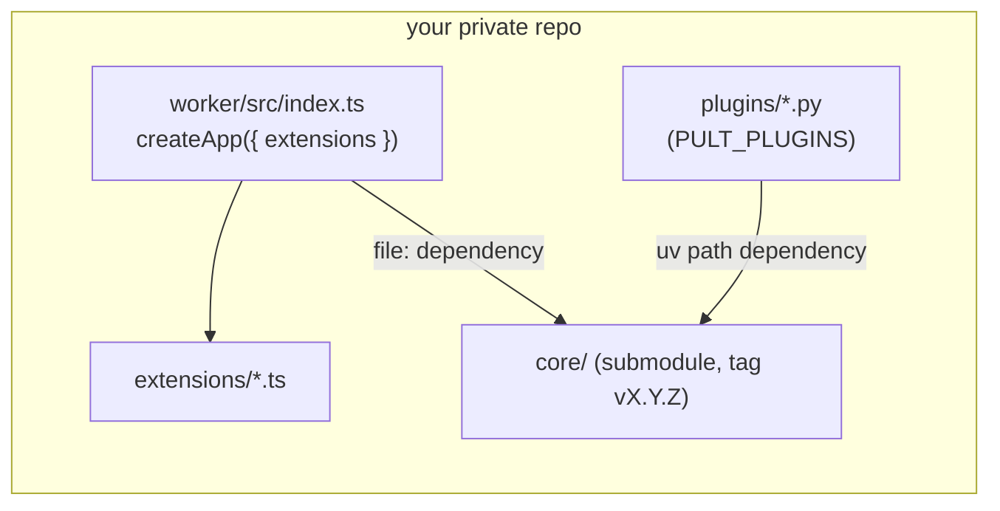

# Extending pult

pult is a core. Your own layer (CRM, scheduled jobs, a family chat, a wall display) lives in a separate, private repo and plugs into the core through a small, typed set of hooks. Nothing is patched and nothing is forked: the core ships as a git submodule pinned to a tag, and a core change is made here first.



## Layout of a private repo

```
my-bot/
  core/                      git submodule of pult, checked out at a tag
  worker/
    package.json             "dependencies": { "pult-worker": "file:../core/worker" }
    wrangler.toml            main = "src/index.ts"
    src/index.ts             export default createApp<MyEnv>({ extensions: [crm, wall] })
    src/extensions/*.ts
  mac/
    pyproject.toml           dependencies = ["pult"]  and  [tool.uv.sources] pult = { path = "../core" }
    plugins/*.py             modules named in PULT_PLUGINS
```

```bash
git submodule add <pult-url> core && git -C core checkout v0.2.0
cd worker && npm install && npx wrangler deploy --dry-run   # bundles the core through the file: link
```

Upgrading is `git -C core fetch --tags && git -C core checkout v0.3.0`, the tests, then a commit of the submodule pointer.

## The worker side: `createApp({ extensions })`

```ts
import { createApp, type Extension } from 'pult-worker';

interface MyEnv { CRM_TOKEN: string }                      // the extension's own bindings
const crm: Extension<MyEnv> = { name: 'crm', /* hooks */ };
export default createApp<MyEnv>({ extensions: [crm] });     // Env of the whole worker = core Env & MyEnv
```

`createApp` validates every extension before the first request and throws on a name clash, a migration id without the extension's prefix, a command that shadows a core command, a callback prefix that overlaps another, or a queue action that shadows a core one.

| Hook | Shape | What it gets |
|---|---|---|
| `name` | `[a-z][a-z0-9_]{1,15}` | namespace for everything below |
| `migrations` | `[{ id: '<name>:0001_x', sql: string \| string[] }]` | applied after the core's, once each, in order, each in one D1 batch with its bookkeeping row (`_migrations`). Additive only; give an array when a statement contains a semicolon or a trigger |
| `routes` | `[{ method, path: string \| RegExp, auth?: 'key' \| 'tma' \| 'public', handler(req, ctx) }]` | served under `/x/<name>/<path>`. `key` (default): the bearer `RUN_KEY`. `tma`: the owner's Mini App initData. `public`: no check, yours to do |
| `commands` | `[{ name, description, run(c) }]` | slash commands behind the owner gate, listed in the menu by `/setup`. `c.args`, `c.reply(text, markup?)`, `c.env`, `c.db`, `c.tg`, `c.api` |
| `callbacks` | `[{ prefix: 'abc:', run(c) }]` | buttons whose `callback_data` starts with the prefix; `c.data` is the rest. Never trust it: validate |
| `queueActions` | `{ ping: { onAck(ctx, ev, ack) } }` | names you queue with `enqueue(db, { action: 'ping', ... })`; the Mac side's registry runs them; `onAck` runs here when the runner acks (status, body) |
| `scheduled` | `(ctx, ev) => Promise<void>` | after the core's hourly sweep on every cron trigger; check `ev.cron` if you have several |
| `panels` | `[{ id, title, data(ctx) }]` | a Mini App tab. `data` returns `{ rows }`, `{ kv }` or `{ text }` and the page renders it with `textContent`: no script of yours reaches the app |
| `help` | string | a line appended to `/help` |

The context of every hook: `env` (core plus yours), `db` (D1), `tg` (the core's Telegram interface: send, edit, delete, draft), `api` (grammY `Api` for anything else), `owner`, `tz`, `now`. The library exports the helpers extensions usually need from `pult-worker`: `enqueue`, `getSetting`/`putSetting`, `listItems`, `applyAction`, `reconcile`, `resolveSession`, `callbackData`, `mdToTg`, `validateInitData`.

### The worked example

`worker/examples/toy.ts` is a complete extension: a `/ping` command that answers with a button, the button queueing an action for the Mac, a migration creating a table, the ack hook recording its result, a route, and a Mini App panel. `worker/examples/toy.test.ts` drives all of it through the worker's front door, so the example cannot rot. Read the two files together; each hook is numbered in the comments.

## The Mac side: plugins

`pult-run` and `session-run` load the modules named in `PULT_PLUGINS=a.b,c.d` with `importlib`. A module defines `register(registry)` and optionally `workflows()`:

```python
# tests/plugins/toy_ping.py
from pult.actions import ActionResult

def ping(ev, ctx):                       # ev: the event dict from the worker; ctx: pult.actions.Ctx
    return ActionResult(say="pong")      # status 'done' by default; no model involved

def register(registry):
    registry.register("ping", ping, workflow="draft")

def workflows():                         # optional
    return {"draft": {"disallowed_tools": ["Read(**/toy-secret*)"]}}
```

- `registry.register(name, handler, *, workflow='draft', item_result=False)`. A handler returns `ActionResult(status, say, item_result, loud)` or `None` (nothing posted, nothing acked: the lease is already lost). A handler is deterministic code unless it calls `ctx.run_claude(prompt)`.
- The built-in actions (`ask`, `reply`, `c1` to `c3`) run Claude. Any other action goes through the registry; an unknown one is acked `failed` with a clear line and never reaches Claude.
- A plugin may add workflows. It cannot weaken `draft`: the only accepted change to it is more `disallowed_tools`. Anything else raises `PluginError`.
- A plugin that fails to import stops `pult-run` at startup (exit 78), loudly. It is never skipped silently.
- Paths and keys come from the environment only (`pult.paths`); `PULT_WORKFLOWS` replaces the packaged `workflows.json` entirely.

The Python test for the toy plugin is `tests/test_actions_and_plugins.py`; the worker test for its other half is `worker/examples/toy.test.ts`.

## A Mini App panel

```ts
panels: [{ id: 'pings', title: 'Pings', async data(c) {
  const { results } = await c.db.prepare('SELECT n, note FROM toy_pings ORDER BY n DESC LIMIT 20').all<{ n: number; note: string }>();
  return { rows: results.map(r => ({ title: `ping #${r.n}`, badge: r.note, focus: String(r.n) })) };
} }]
```

It becomes a tab. A deep link `https://t.me/<bot>/<app>?startapp=panel_pings_3` opens the tab and highlights the row whose `focus` is `3`. The panel reads your own tables; the core never sees your private data and the core page never loads your code.

## Mapping a larger private layer onto these hooks

| Private-layer part | Hook |
|---|---|
| Family layer (other people allowed to use the bot) | out of the core by design (one owner): a second webhook as a `public` route under `/x/family/` with its own gate, its own tables through `migrations`, replies through `c.api` |
| Mini App read model (registry, to-do lists, private-row redaction) | `panels` for the views, `routes` with `auth: 'key'` for the Mac's push, `migrations` for the read-model tables; redaction lives in the panel's `data` |
| Claim-check (gate before anything leaves) | `routes` (`key`) for the check, `callbacks` for approve and reject buttons, `queueActions` for the Mac side, a plugin action for the check itself |
| Wall display | a `public` or `key` route returning the data the display polls, `panels` for the phone view |
| Scheduled jobs | `scheduled` for worker-side ticks; Mac-side jobs stay scripts calling `bot-item` and `bot-say`, or plugin actions queued at priority 2 |
| Draft-send (Gmail and similar) | `callbacks` (the two-tap confirm), `queueActions` with an `onAck` that closes the card, a plugin action holding the send path. The core stays read-and-draft |
